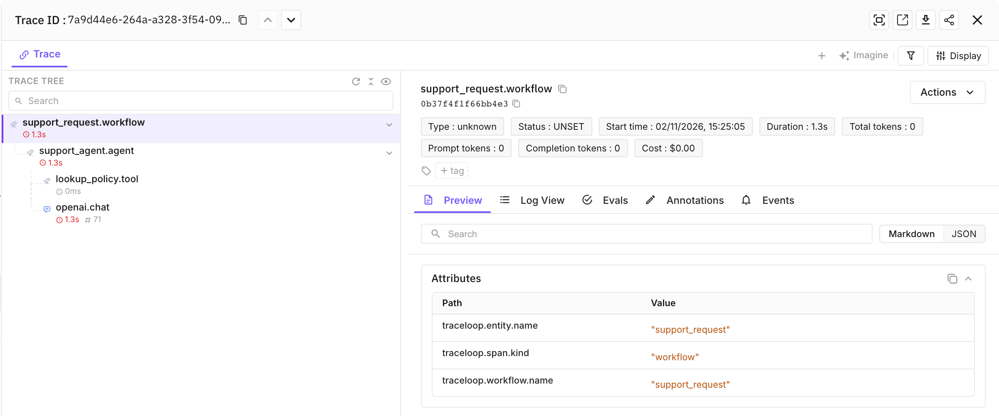

<Frame>
  
</Frame>

Future AGI receives OpenLLMetry traces over OTLP/HTTP and shows them in its Observe view. For what is captured, privacy settings and troubleshooting, see the [Future AGI OpenLLMetry guide](https://docs.futureagi.com/docs/integrations/otel/openllmetry).

### To Log Traces to Future AGI

Install the SDK, the OpenAI client and `httpx`:

```bash
pip install traceloop-sdk openai httpx
```

Export your Future AGI keys as `FI_API_KEY` and `FI_SECRET_KEY` and your OpenAI key as `OPENAI_API_KEY`. Then set the exporter variables:

```bash
# Future AGI Cloud. The SDK appends /v1/traces.
# Self-hosted: use your collector origin, without /v1/traces.
export TRACELOOP_BASE_URL="https://api.futureagi.com/tracer"

export TRACELOOP_HEADERS="x-api-key=${FI_API_KEY},x-secret-key=${FI_SECRET_KEY}"

# Does not suppress exception/status text or the OpenAI base URL; see Privacy.
export TRACELOOP_TRACE_CONTENT=false     # the SDK default is true
export TRACELOOP_METRICS_ENABLED=false   # the collector serves no /v1/metrics
unset TRACELOOP_API_KEY                  # that key is for Traceloop's own host
```

The block turns content capture off; the [Privacy section](https://docs.futureagi.com/docs/integrations/otel/openllmetry#privacy) of the Future AGI guide lists what that switch does not cover.

Set the Future AGI project as resource attributes. The collector rejects a batch whose resource has no `project_name` (HTTP 400) and creates the project on first use. Here is an example:

```python
from traceloop.sdk import Traceloop

Traceloop.init(
    app_name="my-app",  # exported as service.name
    resource_attributes={
        "project_name": "openllmetry_project",
        "project_type": "observe",
    },
    telemetry_enabled=False,
)

from openai import OpenAI
from traceloop.sdk.decorators import agent, tool, workflow

@tool(name="lookup_policy")
def lookup_policy(question: str) -> str:
    return "Refunds are accepted within 30 days of purchase."

@agent(name="support_agent")
def support_agent(question: str) -> str:
    facts = lookup_policy(question)
    response = OpenAI().chat.completions.create(
        model="gpt-4o-mini",
        messages=[
            {"role": "system", "content": "Answer using only these facts: " + facts},
            {"role": "user", "content": question},
        ],
    )
    return response.choices[0].message.content or ""

@workflow(name="support_request")
def support_request(question: str) -> str:
    return support_agent(question)

print(support_request("What is the refund window?"))
```

A short script exports on normal exit (the SDK registers an `atexit` flush). Open **Observe** in Future AGI and select `openllmetry_project` to inspect the trace. Each decorated function and model call becomes a span, with parent links matching your code.
